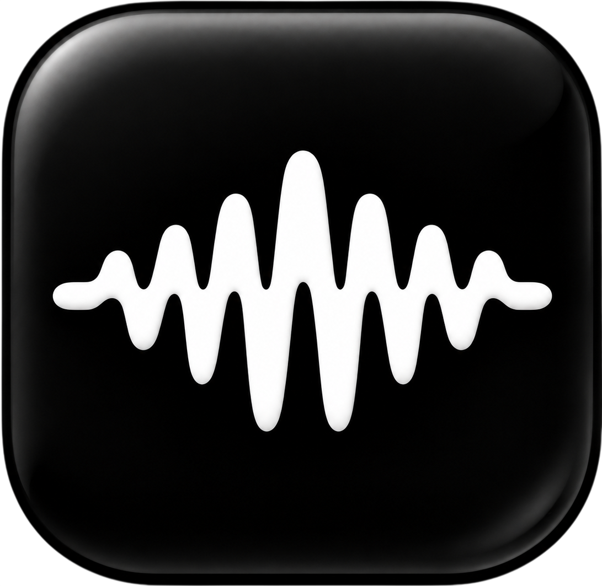

 
 

# SoundChord

### Aesthetic & Modular YouTube Music Client

 

 

[**Descargar APK**](#download) · [**Características**](#features) · [**Contribuciones**](#contributing) · [**Aviso Legal**](#disclaimer)

> [!IMPORTANT]
> SoundChord es una aplicación independiente de código abierto y no está afiliada, respaldada ni vinculada oficialmente con YouTube o Google.

---

<h1>Características Destacadas</h1>

<table>
  <tr>
    <td width="50%" valign="top">

#### Reproducción y Audio
- **Streaming de alta fidelidad** — Búsqueda y reproducción desde YouTube Music con soporte para formatos FLAC/Lossless en módulos compatibles.
- **Transmisión de Radio en Vivo & Estaciones por Tema** — Integración completa con Radio Browser, países con paletas dinámicas y secciones de temas/estaciones recientes.
- **Reconocimiento de canciones tipo Shazam** — Botón flotante animado para identificar música en tiempo real mediante el micrófono del dispositivo.
- **Sesiones Escuchar Juntos con Control Remoto** — Modo de silenciado local de audio para actuar únicamente como controlador remoto sin interrumpir la transmisión en la PC.
- **Crossfade y transiciones sin pausas** — Transiciones fluidas de 0 a 12 segundos entre canciones.
- **Reproducción local y descargas** — Guarda pistas con metadatos embebidos e integra la música almacenada en tu dispositivo.

    </td>
    <td width="50%" valign="top">

#### Experiencia e Interfaz
- **Diseño "Liquid Glass" (Glassmorphism)** — Diálogos informativos de calidad de audio, controles de reproductor y menús flotantes translúcidos estilizados.
- **Pantalla Explorar Modular** — Carruseles destacados, selecciones según estado de ánimo, listas de éxitos por país y recomendaciones dinámicas.
- **Letras sincronizadas palabra por palabra** — Animación tipo Apple Music con soporte multi-proveedor (Musixmatch, LRCLIB, BiniLyrics, Genius).
- **Temas dinámicos por carátula** — Extracción automática de paletas Material 3 según el arte del álbum.
- **Actualizador integrado del repositorio** — Notificaciones de actualización directa apuntando a lanzamientos firmados de `808andrex/SoundChord`.

    </td>
  </tr>
</table>

---

<h1>Descargas (Versión 1.0)</h1>

Obtén el APK oficial firmado desde la sección de [Releases de GitHub](https://github.com/808andrex/SoundChord/releases).
### ⚠️ Nota sobre la instalación (Play Protect)

Al instalar el APK por primera vez fuera de la tienda Google Play, es posible que el sistema Android o Google Play Protect muestren la pantalla de advertencia *"Se recomienda analizar la app"* o *"App de origen desconocido"*.

**Para completar la instalación:**
1. En el mensaje emergente de instalación, toca en la opción **Más detalles**.
2. Selecciona **Instalar de todos modos** (o *Instalar sin analizar*).

*SoundChord es 100% seguro, de código abierto y sin rastreadores comerciales.*

---

<h1>Créditos y Origen</h1>

SoundChord es un fork modular desarrollado por [808andrex](https://github.com/808andrex), basado originalmente en el proyecto de código abierto **BitChord** de [kushagrasinghx](https://github.com/kushagrasinghx). 

Gracias a la comunidad de desarrolladores y proyectos open-source que hicieron posible este reproductor.

---

<h1>Aviso Legal</h1>

SoundChord es un cliente de audio de código abierto desarrollado estrictamente con fines educativos y de investigación personal.

* **Sin Alojamiento de Archivos:** SoundChord no aloja ni distribuye archivos de audio con derechos de autor. Funciona exclusivamente como un cliente para indexar la biblioteca local del teléfono o reproducir contenido mediante fuentes y APIs públicas.
* **Licencia Copyleft:** Publicado bajo la licencia **GNU General Public License v3.0 (GPLv3)**.

