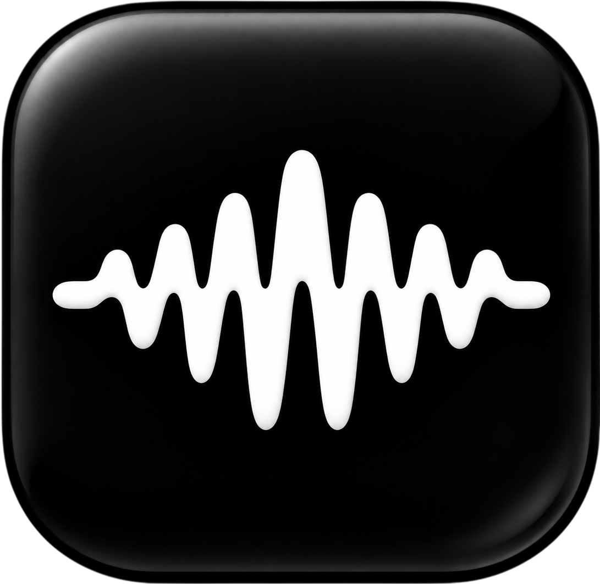

 
 

# SoundChord

### Aesthetic & Modular YouTube Music Client

 

 

[**English**](README.md) · [**Español**](README.es.md)

 

[**Download APK**](#download) · [**Features**](#features) · [**What's New v1.3.0**](#whats-new) · [**Architecture**](#architecture) · [**Credits**](#credits) · [**Privacy**](#privacy) · [**Disclaimer**](#disclaimer)

> [!IMPORTANT]
> SoundChord is an independent open-source application and is not affiliated, endorsed, or officially connected with YouTube or Google.

---

<h1>Key Features</h1>

<table>
  <tr>
    <td width="50%" valign="top">

#### Playback & Audio
- **High-Fidelity Streaming** — Search and stream from YouTube Music with support for lossless audio formats (FLAC / Lossless / DSD) on compatible modules.
- **Global Radio & Custom Stations** — Browse radio stations organized by genre and country with vibrant Apple Music-inspired gradients, automatic mirror server rotation, custom stations, *Liquid Glass* context menus, and recent playback history.
- **AutoMix & Gapless Playback** — Intelligent DJ mixes matching tempo (BPM) and harmonic key with an animated progress bar, crossfade on next/previous track, and automatic pause for albums to preserve original transitions.
- **Music Recognition (Shazam) + History** — Real-time song identification via microphone with persistent local history, instant search, and direct playback.
- **Listen Together Sessions & Google Drive Backups** — Real-time remote playback control across devices and optional cloud backup for your *Replay* history, playlists, and settings on Google Drive.
- **Local Playback & Downloads** — Cache and download tracks with embedded metadata and seamlessly integrate audio stored on your device.

    </td>
    <td width="50%" valign="top">

#### Experience & Interface
- **Interactive Onboarding & Global Accent Color** — 4-step onboarding flow featuring smart artist selection, live theme/glass preview, dynamic accent color palette, and alternative app icons (*Monochrome*, *Classic Red*, *Spotify Green*).
- **"Liquid Glass" Design & iOS-Style Physics** — Translucent floating cards adaptive to Light and Dark themes, smooth AGSL shared element cover transitions, spring physics, animated covers, and Spotify Canvas support.
- **Home Screen Widgets & Fullscreen Video** — Redesigned Apple Music / iOS-style home screen widgets and minimalist controls for fullscreen video playback.
- **Fast Queue & Playlist Management** — Create and edit playlists with custom cover art picker and YouTube Music sync, multi-select and swipe gestures in the queue, and circular Shuffle/Autoplay status badge.
- **Time-Synced Lyrics (Word-by-Word)** — Apple Music-style lyrics animation with multi-provider integration (Musixmatch, LRCLIB, BiniLyrics, Genius).
- **OTA Updater & Built-in Release Notes** — Automatic GitHub Releases update checker with a floating release modal, categorized changelog, and direct in-app APK installation.

    </td>
  </tr>
</table>

---

<h1>What's New in v1.3.0</h1>

- **New Radio Tab with Vibrant Gradients & *Liquid Glass* Menus:** Explore stations by genre and country with Apple Music-inspired artwork cards, scroll position preservation, custom radio stations with clean dividers, and floating context menus with haptic feedback on long press.
- **Intelligent AutoMix & Gapless Album Playback:** Automatic mixing engine analyzing key and tempo with an animated mixing indicator (*Mixing*), gapless mode for seamless album listening without artificial fades, and restored manual crossfade when skipping tracks or picking songs from playlists.
- **Redesigned iOS / Apple Music-Style Widgets & Fullscreen Video:** Brand new home screen widgets and refined minimalist fullscreen video controls.
- **Advanced Playlist Creation, Editing & Quick Controls:** New *New Playlist* screen with custom cover selection and YouTube Music sync, *Edit playlist* dialog (title & cover), optional Shuffle and Repeat buttons on the mini-player bar, and circular status badge on the Queue button.
- **Redesigned What's New, OTA Updates & Fluid Transitions:** New floating bottom sheet with Hero card, animated sound wave, and collapsible accordions for *Update Available* and *Release Notes*, alongside smoother animations, real-time accent color theming, and production-ready Google Drive backups.

---

<h1>Architecture & Tech Stack</h1>

SoundChord is built on a **Kotlin Multiplatform / Android Modular** architecture designed to keep custom features completely decoupled from the playback core:

- **Language & UI:** Kotlin, Jetpack Compose, Material 3, Haze (Glassmorphism), and native AGSL shaders.
- **Audio Engine:** Media3 / ExoPlayer supporting high-resolution audio processing, AutoMix, dynamic crossfade, gapless playback, and remote playback sessions.
- **Modular Structure:**
  - `:app` — Android entry point, main navigation, widgets, Google Drive backup integration, OTA updater, and platform-specific implementations.
  - `:shared` & `:sharedUi` — Shared business logic, player UI components, animations, multiplatform resources, and domain models.
  - `:soundchord:features` — Dedicated feature module for SoundChord-exclusive functionality (*Radio Browser & Stations*, *Shazam & History*, *Liquid Glass* dialogs, and *Audio Output* switcher).

---

<h1>Download (Version 1.3.0)</h1>

Get the official signed APK from the [GitHub Releases](https://github.com/808andrex/SoundChord/releases/latest) page (choose **`arm64-v8a`** for modern Android devices, or **`universal`** if you are unsure of your device architecture).

### ⚠️ Installation Note (Play Protect)

When installing the APK for the first time outside of Google Play, Android may display an *"Unrecognized app / Play Protect recommends scanning"* prompt because each release generates a unique digital signature:

1. Tap **Scan app** to complete Google's automatic security verification (recommended).
2. If you prefer to bypass scanning, tap **More details** and select **Install anyway**.

*SoundChord is 100% safe, open-source, and contains zero commercial trackers.*

---

<h1>Credits & Origin</h1>

SoundChord is a modular fork developed by [808andrex](https://github.com/808andrex), originally based on the open-source project **BitChord** by [kushagrasinghx](https://github.com/kushagrasinghx).

Special thanks to the open-source developer community and projects that make this player possible.

---

<h1>Privacy</h1>

SoundChord stores your *Replay* history, downloads, and preferences locally on your device. Optional Google Drive backups strictly use the restricted `drive.file` scope to manage only the files created by the application itself.

For more details, read the full [Privacy Policy (`PRIVACY.md`)](https://github.com/808andrex/SoundChord/blob/main/PRIVACY.md).

---

<h1>Legal Disclaimer</h1>

SoundChord is an open-source audio client developed strictly for educational and personal research purposes.

- **No File Hosting:** SoundChord does not host or distribute copyrighted audio files. It operates exclusively as a client to index your local music library or stream content via public APIs and sources.
- **Copyleft License:** Released under the **GNU General Public License v3.0 (GPLv3)**.

